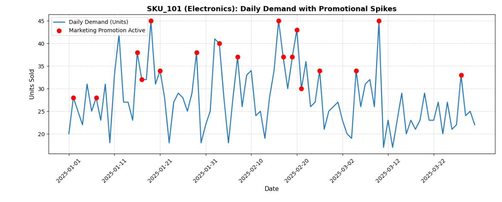

# Omnichannel Demand Forecasting & Inventory Optimization

## Business Overview
In omnichannel retail, promotional marketing drives volume spikes that often disrupt downstream warehouse operations. Unaligned replenishment creates stockouts during campaign peaks and elevated holding costs during baseline periods.

This project analyzes a 365-day retail dataset across 10 SKUs to synchronize promotional demand drivers with warehouse inventory policies.

---

## Visualizing Promotional Demand Spikes

---

## Core Analytical Deliverables & Methodology

### 1. ABC-XYZ Matrix Segmentation
* **ABC Classification (Revenue Contribution):** Segmented SKUs via Pareto analysis (Class A: ~75% revenue, Class B: ~17%, Class C: ~8%).
* **XYZ Classification (Demand Volatility):** Measured demand stability via the Coefficient of Variation ($CV = \frac{\sigma}{\mu}$):
  * **Class X ($CV \le 0.15$):** Highly predictable demand; candidate for automated replenishment.
  * **Class Y ($0.15 < CV \le 0.22$):** Moderate variability; requires seasonal adjustment.
  * **Class Z ($CV > 0.22$):** High promotional sensitivity; requires dynamic safety buffers.

### 2. Marketing Promotional Lift Quantification
* Isolated demand during marketing campaign days versus baseline sales.
* Quantified an average promotional demand lift of **36% to 46%** across categories, providing actionable lead times for promotional procurement.

### 3. Inventory Replenishment Policies
* **Safety Stock ($SS$):** Sized buffer inventory targeting a **95% Cycle Service Level** ($Z = 1.65$) under supplier lead-time constraints:
  $$SS = Z \times \sigma_d \times \sqrt{L}$$
* **Reorder Point ($ROP$):** Set automated purchase triggers combining lead-time consumption and safety inventory:
  $$ROP = (\mu_d \times L) + SS$$

---

## Technical Architecture
* **Language:** Python
* **Libraries:** Pandas (ETL & Aggregations), NumPy (Statistical Modeling), Matplotlib (Time-Series Visualization)
* **File Structure:**
  * `omnichannel-inventory-demand-optimization.ipynb`: Full end-to-end executable workflow
  * `promo_demand_spikes.png.png`: Visual promotional spike plot

---

## Strategic Takeaway
Dynamic safety stocks calibrated to marketing calendars protect customer fulfillment rates during promotion peaks without inflating working capital on steady-demand lines.
